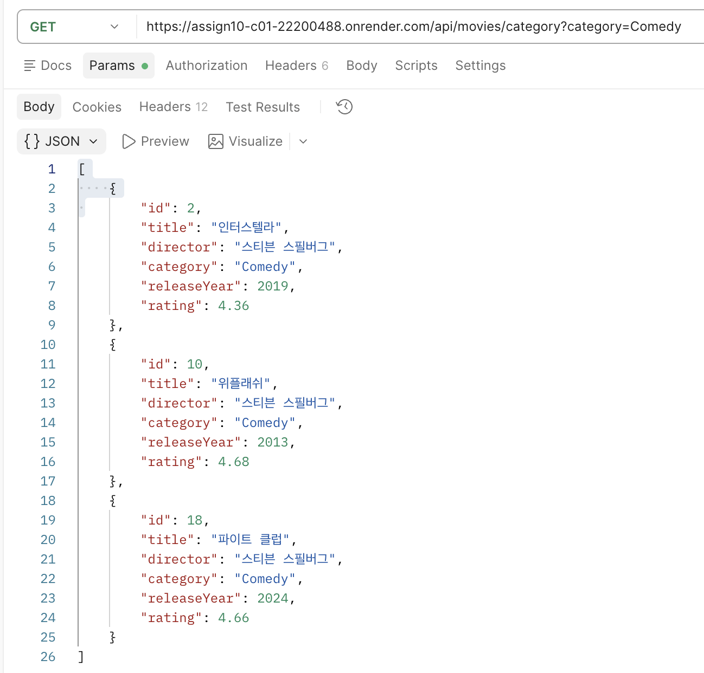
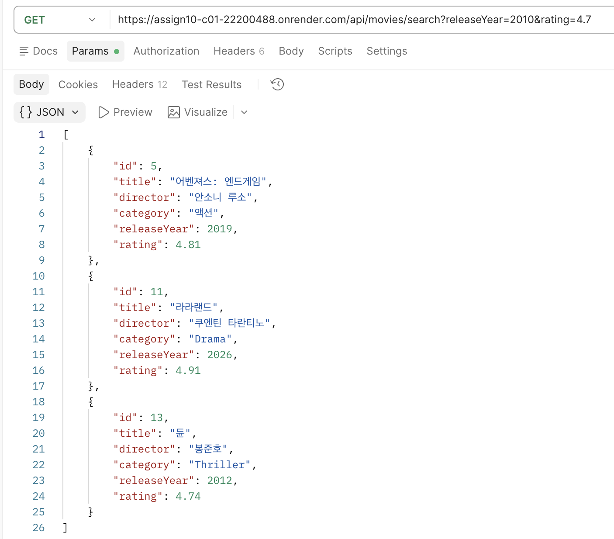
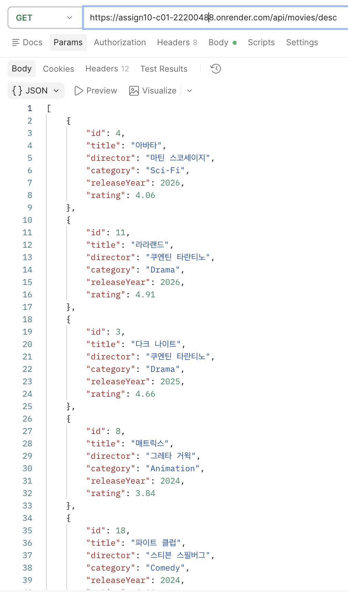
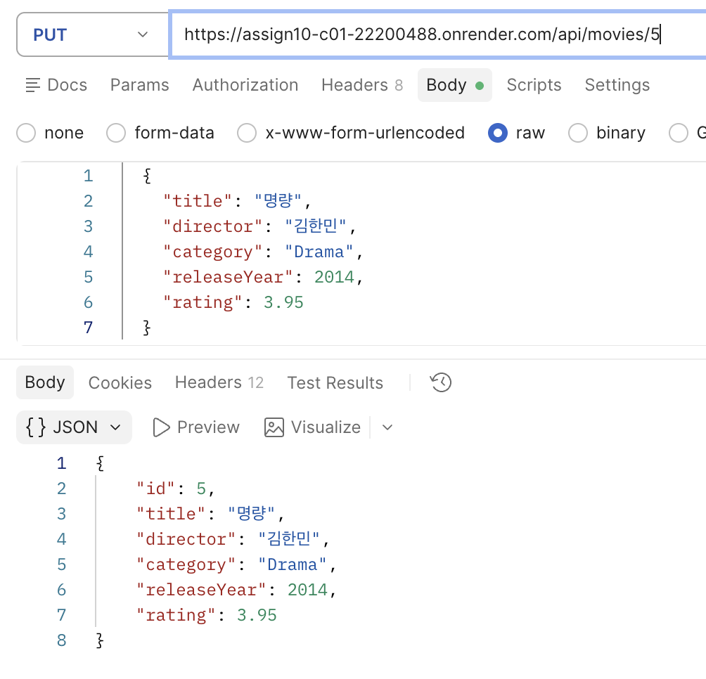
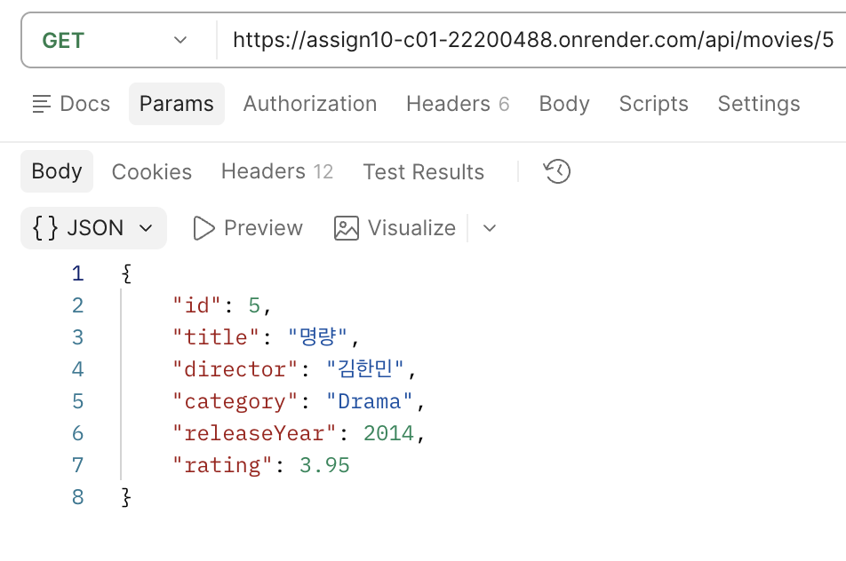

# 웹 서비스 개발 10주차 과제: Spring Data JPA 응용 및 기능 확장

---

## ① 프로젝트 소개
### 주제 및 주요 기능
- 주제
  - 영화 목록 관리 프로그램
- 주요 기능
  - 영화 생성
  - 영화 전체 조회
  - 영화 단건 조회
  - 영화 수정
  - 영화 삭제
  - 단일 조건 검색: 카테고리별 조회
  - 복합 조건 검색: 특정 개봉연도 이상, 특정 평점 이상인 영화 조회
  - 정렬 포함 검색: 최신 개봉연도 순으로 전체 조회

### GitHub & Render URL
| 구분 | 링크 |
| :--- | :--- |
| **Render 배포 URL** | https://assign10-c01-22200488.onrender.com |
| GitHub (Organization) | https://github.com/2026-2-WebService/assign10-c01-22200488 |
| GitHub (Personal) | https://github.com/dbseend/assign10-c01-22200488 |

## ② 주요 구현 내용 및 결과
### Query Method 3개: 검색 조건 및 API 실행 결과
- 단일 조건 검색: 카테고리별 조회 (`GET /api/movies/category?category=Comedy`)

- 복합 조건 검색: 특정 개봉연도 이상이면서 특정 평점 이상인 영화 조회 (`GET /api/movies/search?releaseYear=2010&rating=4.7`)

- 정렬 포함 검색: 최신 개봉연도 순으로 전체 조회 (`GET /api/movies/desc`)

### Dirty Checking: 수정 기능 구현 및 실행 결과
- `@Transactional`과 Dirty Checking을 통해 `save()` 호출 없이 수정 기능 구현
- 수정 요청 (`PUT /api/movies/5`)

- 수정 후 조회 (`GET /api/movies/5`): 변경된 값이 반영된 것을 확인

### Auditing: 생성·수정 시간 자동 기록 결과

## ③ Weekly Report
### Key Learning: 새롭게 배운 내용 2~3가지
1. Query Method: 필요에 따라 특정 필드 기반의 복잡한 조건 검색 및 필터링 쿼리를 유연하게 구현 가능
2. EntityListener: 엔티티의 생명주기 이벤트를 감지하여 생성일(createdAt)과 수정일(updatedAt)을 데이터베이스에 자동 반영

### Problem & Solution: 어려웠던 점과 해결 방법
- 문제: `createdAt`, `updatedAt` 같은 `LocalDateTime` 필드를 추가하고 `hibernate.ddl-auto=update`로 테이블에 자동 반영하려 했으나, DDL 오류가 발생해 컬럼이 추가되지 않음
- 원인: DB가 MariaDB 10.1.48인데 `ALTER TABLE IF EXISTS`는 10.5 이상에서만 지원됨. 사용 중인 Hibernate가 최신 문법의 DDL을 생성해 문법 오류가 발생함
- 해결: `hibernate.ddl-auto`를 `validate`로 변경하고, DBeaver에서 컬럼을 추가하는 쿼리를 직접 실행함

### Reflection: 이번 과제를 통해 느낀 점
- 실제 서비스에서는 JPA가 기본 제공하는 메서드만으로는 부족하고, Query Method를 직접 작성해 더 복잡한 기능을 구현할 필요가 있다고 느낌. 더 나아가 SQL을 공부해 복잡하면서도 효율적인 쿼리를 작성하는 능력이 필요하다고 느낌

## ④ AI Usage
- 사용한 AI 도구: Claude
- 사용한 부분: DDL 오류 발생 문제 원인 분석, Auditing 리스너 오류 원인 분석
